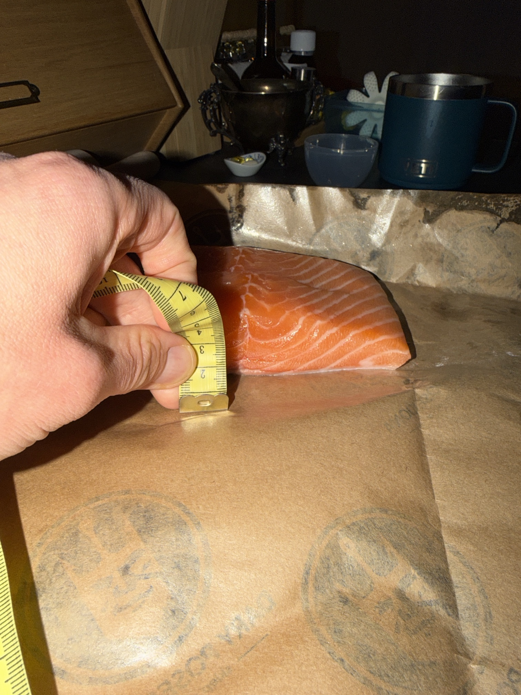

# Łosoś z piekarnika: notatki

Przepis: [przepis.md](../../przepis.md)

## Pieczenie 1 (16.11.2026)

Filet ze skórą, grubość ok. 5 cm, zmierzona przed pieczeniem.

Do uzupełnienia po degustacji:
- czas i temperatura w moim piekarniku:
- temperatura w środku / soczystość:
- przyprawy (czosnek, cytryna, zioła):
- co zmienić następnym razem:
